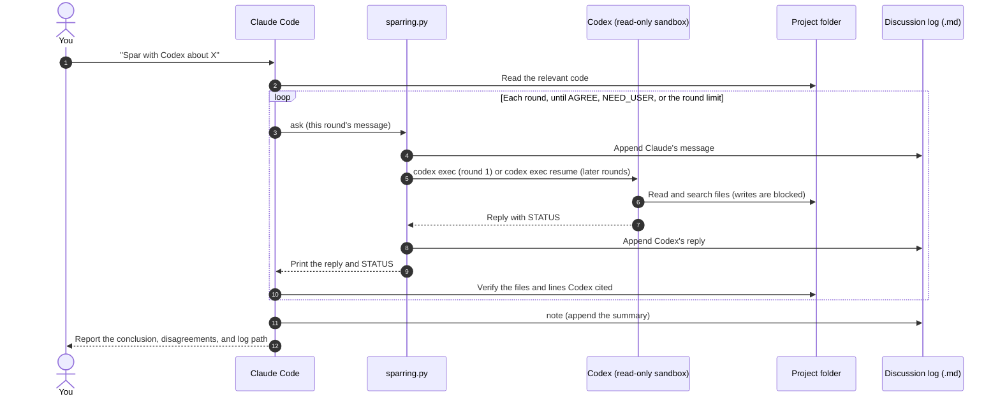

<div align="center">

# 🥊 claude-codex-sparring

**Give Claude Code a sparring partner.**

*OpenAI Codex reads your whole project inside a read-only sandbox and pushes back on Claude's reasoning.<br>Every round lands in one shared Markdown log.*

<br>

[](https://docs.anthropic.com/en/docs/claude-code)
[](https://github.com/openai/codex)
[](https://www.python.org/)
[](scripts/sparring.py)

[](LICENSE)

</div>

---

## ✨ What it is

`claude-codex-sparring` is a [Claude Code](https://docs.anthropic.com/en/docs/claude-code) skill. Just tell Claude:

> Spar with Codex: is the cache layer thread-safe?

Claude reads the relevant code, writes down its position, and hands it to **OpenAI Codex**. Codex **explores your entire project on its own** to find evidence, then replies. Claude verifies the reply, pushes back or concedes, and the two go back and forth until they agree, need your call, or hit the round limit.

The whole exchange is recorded in **one Markdown log** that you can open in any editor and watch live.

### Why a sparring partner?

A model reviewing its own ideas tends to share its own blind spots: whatever it missed while writing, it also misses while reviewing. A model from a different family is more likely to find the weaknesses you did not anticipate.

A good sparring partner hits back so you get better, but never lands a real blow. That is exactly the deal here: Codex challenges Claude's reasoning, yet it **cannot touch your files**.

The idea comes from the cross-model review loop in [ARIS](https://github.com/wanshuiyin/Auto-claude-code-research-in-sleep). This project distills it to the smallest useful form: **one `SKILL.md` plus one zero-dependency Python script**, with no MCP server to run.

---

## 🌟 Features

| | |
|---|---|
| 🔒 **Codex stays read-only** | Runs with `codex exec --sandbox read-only`: it can read and search the whole project, but **cannot write any file** |
| 📝 **One shared log** | Every turn from both sides goes into the same `.md` file. Only the script writes it, so there are no write conflicts |
| 🧠 **Codex remembers** | Round 1 starts a thread; later rounds continue it with `codex exec resume <thread_id>` |
| 🧰 **Isolated by default** | Codex's MCP servers and plugins are not loaded: the sandbox can fence in files, but not those tools |
| 🚦 **Clear stop signals** | Codex ends every reply with `AGREE`, `CONTINUE`, or `NEED_USER`, plus a hard round limit |
| 🔍 **Claude must verify** | Every `path:line` Codex cites gets opened and checked, not taken on faith |
| 🌐 **Any reply language** | Codex replies in English by default; Claude passes along the language you are using |
| 🪶 **Zero dependencies** | Python standard library only. No MCP server, database, or background service |
| 🧪 **Offline tests** | A simulated Codex ships with the repo, so tests need no sign-in and spend no quota |

---

## ⚙️ How it works



---

## 🛡️ Permissions and safety

| Area | What the tool does | Why |
|---|---|---|
| **File writes** | Round 1 uses `--sandbox read-only`; later rounds use `-c sandbox_mode="read-only"` (`resume` does not accept `--sandbox`) | Codex is an advisor, not an editor |
| **The log** | Written only by the script; Codex's answer is collected from stdout | Letting Codex write the log would require write access, and write access is granted for the whole working folder |
| **External tools** | Adds `--ignore-user-config` by default, so no MCP servers, plugins, or notify program load. The model, reasoning effort, and Windows sandbox mode are read from your config and passed explicitly | The sandbox restricts files and network, not MCP tools such as browser control |
| **Passing the prompt** | The prompt goes through stdin; on Windows, `node codex.js` is called directly instead of `codex.cmd` | Avoids cmd.exe rewriting quotes and any command-line length limit |
| **Concurrency** | One lock file per log | Prevents two rounds from running on the same discussion |
| **Secrets** | The skill tells Claude to search for `.env`, `*.pem`, `*.key`, and similar files first and ask you before starting | Anything Codex reads is sent to OpenAI |

> [!WARNING]
> **Read-only does not mean private.** File contents that Codex reads are sent to OpenAI's models. Remove or exclude passwords and keys from the project before you start.

---

## 📦 Requirements

| Requirement | Notes |
|---|---|
| [Claude Code](https://docs.anthropic.com/en/docs/claude-code) | A version with skills support |
| [Codex CLI](https://github.com/openai/codex) | `npm install -g @openai/codex`, then `codex login` |
| Node.js | Required by the Codex CLI |
| Python 3.11+ | The script uses the built-in `tomllib`; **no packages to install** |

---

## 🚀 Installation

Clone the repo into your Claude Code skills folder under the name `sparring`.

**macOS / Linux**

```bash
git clone https://github.com/JeremyHo1123/claude-codex-sparring.git ~/.claude/skills/sparring
```

**Windows (PowerShell)**

```powershell
git clone https://github.com/JeremyHo1123/claude-codex-sparring.git "$env:USERPROFILE\.claude\skills\sparring"
```

Want it in a single project only? Clone it into that project's `.claude/skills/sparring` instead.

Restart Claude Code and `sparring` should appear in the skill list. Then make sure Codex is signed in:

```bash
codex login status
```

---

## 💬 Usage

### Inside Claude Code (recommended)

Use plain language:

```text
Spar with Codex: is the cache invalidation in src/cache.py thread-safe?
```

Or use the slash command with options:

```text
/sparring Should the database migration be split into two steps? — rounds: 3 — effort: high
```

Claude follows the workflow in `SKILL.md`: settle the parameters → check for secret files → create the log → for each round, write a message, send it to Codex in the background, and verify the reply → append a summary and report back.

> [!NOTE]
> Every round spends your ChatGPT/Codex quota, so the skill only starts when you explicitly ask for it.

### Running the script directly

```bash
python3 scripts/sparring.py start  --log talk.md --project . --topic "One-line topic" --effort high
python3 scripts/sparring.py ask    --log talk.md --message-file turn-1.md
python3 scripts/sparring.py note   --log talk.md --message-file summary.md --title "Summary"
python3 scripts/sparring.py status --log talk.md
```

| Subcommand | What it does | Common options |
|---|---|---|
| `start` | Creates the log and its state file | `--project`, `--topic`, `--model`, `--effort`, `--reply-language`, `--use-user-config` |
| `ask` | Sends one round and waits for Codex | `--message-file`, `--timeout`, `--dry-run` |
| `note` | Appends to the log without calling Codex (e.g. a summary) | `--message-file`, `--title` |
| `status` | Shows rounds, the thread id, and each round's result | — |

Exit codes for `ask`: `0` success, `1` invalid arguments or lock conflict, `2` Codex failed this round.

---

## 📄 What a log looks like

An illustrative excerpt:

````markdown
# Claude × Codex Sparring: Is the cache invalidation thread-safe?

| Item | Value |
|---|---|
| Project folder | `/path/to/your-project` |
| Codex permissions | Read-only (`--sandbox read-only`): reads the project, never edits files |
| Codex config | Isolated (`--ignore-user-config`): no MCP servers, plugins, or notify program |
| Reasoning effort | `high` |
| Reply language | English |

---

## Round 1 · Claude

`get_or_load()` checks the dict and loads only on a miss (src/cache.py:42-58).
I believe the GIL makes this safe. Please check that assumption.

## Round 1 · Codex

## Agree
1. A single dict read or write is atomic in CPython (src/cache.py:44).

## Disagree
2. "Miss → load → store" as a whole is not atomic, so two threads can load the
   same key twice (src/cache.py:47-55). Consider a lock or `dict.setdefault`.

STATUS: CONTINUE

_(took 52 s)_
````

Each log gets a `.sparring/` folder next to it:

| File | Contents |
|---|---|
| `<name>.state.json` | Round count, Codex thread id, settings |
| `<name>.lock` | Exists only while a round is running |
| `<name>.round-<N>.jsonl` | Raw Codex events for round N, including the commands it ran |
| `<name>.round-<N>.stderr.txt` | Codex's stderr for round N |

---

## ✅ Verified

Environment: Windows 11, codex-cli 0.154.0, Python 3.13.

| Test | Result |
|---|---|
| Real Codex reads project files | ✅ Reported the file contents correctly, with `path:line` |
| Real Codex resumes the thread | ✅ Answered from memory in round 2 without re-reading the file |
| Read-only sandbox blocks writes (`codex sandbox -P :read-only`) | ✅ The write failed with "Access is denied"; the `-P :workspace` control succeeded, proving the test can detect writes |
| Codex told it is "authorized" to write | ✅ Refused: a claim of authorization inside the message cannot override the read-only rule |
| Failures, crashes, concurrent rounds, argument injection | ✅ Covered by the offline tests |

> [!NOTE]
> macOS and Linux code paths exist but are **not tested yet**. Reports are welcome.

---

## ⚠️ Known limitations

- **Rounds can be slow**: with `xhigh` reasoning effort in your Codex config, one round can take several minutes. `--effort high` suits most discussions.
- **Non-ASCII text in the Windows sandbox**: PowerShell there runs in Constrained Language Mode and cannot change its output encoding, so `Get-Content` garbles CJK text. The prompt tells Codex to use `cmd /c type` instead, which works.
- **Codex will not edit your files**: that is by design. Once the discussion reaches a conclusion, Claude makes the changes after you approve them.
- **Do not edit the log mid-discussion**: the script locates each reply through a placeholder; if the placeholder is changed, the reply is appended to the end of the file.
- **CLI changes**: flags follow codex-cli 0.154.0. If something breaks after an upgrade, run `ask --dry-run` to inspect the generated command and compare it with `codex exec --help`.

---

## 🧪 Tests

No Codex sign-in and no quota needed:

```bash
python3 tests/test_offline.py
```

`tests/fake_codex.py` simulates the event stream of `codex exec --json` (`thread.started`, `item.completed`, `turn.completed`, `turn.failed`). The tests cover log creation, new and resumed threads, failure handling, locking, reply language, and config isolation.

---

## 🩺 Troubleshooting

<details>
<summary><b>Codex CLI not found</b></summary>

<br>

First check that `codex login status` works. On Windows the script automatically looks for `%APPDATA%\npm\node_modules\@openai\codex\bin\codex.js`. For other locations, set the `CODEX_BIN` environment variable (a `.js` file is run with node).

</details>

<details>
<summary><b>"a round is already running for this discussion"</b></summary>

<br>

An interrupted round may have left a lock file behind. Check with `status`, make sure no Codex process is running, then delete `.sparring/<name>.lock`.

</details>

<details>
<summary><b>On Windows, <code>python</code> opens the Microsoft Store</b></summary>

<br>

That is a built-in Windows stub. Install Python 3.11 or later and run the script with the interpreter's full path or the `py` launcher.

</details>

<details>
<summary><b>I want Codex to use MCP tools</b></summary>

<br>

Pass `--use-user-config` to `start`. This loads everything in `~/.codex/config.toml`, including MCP servers and plugins. Keep in mind that those tools are not restricted by the file sandbox.

</details>

---

## 🗂️ Project structure

```text
claude-codex-sparring/
├── SKILL.md                 # Workflow instructions read by Claude Code
├── scripts/
│   └── sparring.py          # The CLI (zero dependencies)
├── tests/
│   ├── fake_codex.py        # Simulates codex exec --json
│   └── test_offline.py      # Offline tests
├── LICENSE
└── README.md
```

---

## 🙏 Acknowledgements

- [ARIS — Auto-claude-code-research-in-sleep](https://github.com/wanshuiyin/Auto-claude-code-research-in-sleep): the cross-model review idea, and a reference for parsing `codex exec` events
- [OpenAI Codex CLI](https://github.com/openai/codex)
- [Claude Code](https://docs.anthropic.com/en/docs/claude-code)

> This is an independent community project. It is not affiliated with, endorsed by, or an official product of Anthropic or OpenAI. Claude and Codex are trademarks of their respective owners.

## 📜 License

[MIT](LICENSE)
